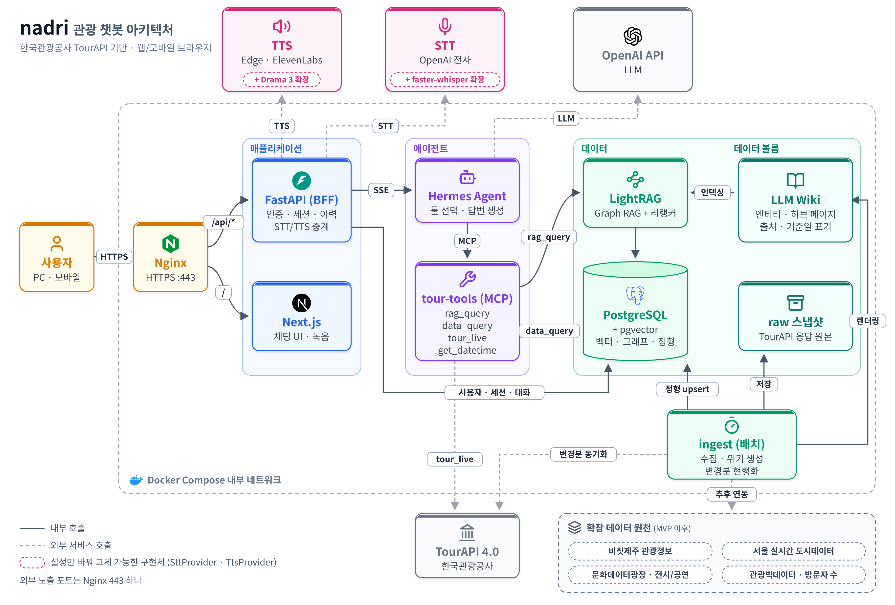

# nadri — 관광 챗봇

한국관광공사 **TourAPI 4.0** 공공데이터를 근거로 답하는 관광 챗봇입니다. PC·모바일 브라우저에서 동작합니다.

> **상태: 설계 단계 (구현 전)**
> 지금은 요구사항을 확정하는 중이고(Phase 1), 아래 내용은 처음 세운 계획을 기준으로 합니다.
> 세부 사항은 기술스택(G2)과 아키텍처(G3) 승인을 거치며 바뀔 수 있습니다. 진행 상황은 [`docs/harness/PROGRESS.md`](docs/harness/PROGRESS.md)에 있습니다.

## 무엇을 하나

- **근거 있는 답변**: 운영시간·요금·위치 같은 관광 정보는 LLM이 기억으로 답하지 않습니다. 공공데이터를 조회한 결과로만 답하고, **출처와 기준일**을 함께 보여 줍니다.
- **하이브리드 검색**: 조건·수치 질문("제주 동쪽 무료 관광지")은 정형 DB 조회로, 서술형 질문("비 오는 날 갈 만한 곳")은 위키 기반 Graph RAG로 답합니다.
- **최신 데이터 유지**: TourAPI의 변경분 동기화 API로 바뀐 항목만 다시 수집해 반영합니다.
- **스트리밍 채팅과 대화 이력**: 로그인한 사용자는 답변을 실시간으로 받고, 지난 대화를 다시 볼 수 있습니다.
- **음성 입출력**: 누르고 말하는(Push-to-talk) 음성 입력과 답변 읽어 주기(TTS)를 지원합니다.

## 아키텍처



실선은 내부 호출, 점선은 외부 서비스 호출입니다. 외부에 여는 포트는 Nginx의 443 하나뿐이고, 나머지 서비스는 Docker Compose 내부 네트워크에만 둡니다.

## 기술 스택

| 영역 | 선택 |
|---|---|
| 프론트엔드 | Next.js (App Router, TypeScript) |
| 백엔드(BFF) | FastAPI (Python) |
| 에이전트 | Hermes Agent (OpenAI 호환 API Server) |
| LLM | OpenAI API: 답변은 `gpt-6-luna`, 제목·요약은 `gpt-5-nano` |
| Graph RAG | LightRAG + 리랭커 (`bge-reranker-v2-m3`) |
| DB | PostgreSQL + pgvector (단일 DB) |
| 툴 연결 | 자체 MCP 서버 `tour-tools` |
| STT / TTS | OpenAI 전사 API / Edge TTS → ElevenLabs (구현체 교체 가능한 인터페이스) |
| 리버스 프록시 | Nginx (HTTPS, SSE 버퍼링 off) |
| 실행 | Docker Compose (WSL2 Ubuntu-22.04에서 개발) |

자세한 내용은 [`TECH_STACK.md`](TECH_STACK.md)에 있습니다.

## 레포 구조 (계획)

```
myAgent/
├── apps/
│   ├── web/            # Next.js
│   └── api/            # FastAPI (BFF)
├── services/
│   ├── tour-tools/     # MCP 서버
│   └── ingest/         # TourAPI 수집 · 위키 생성 · 인덱싱
├── infra/              # compose.yaml, nginx.conf, Hermes 설정 템플릿
├── eval/               # 골든 Q&A 평가셋 · 평가 스크립트
└── docs/
    ├── analysis/       # 사전 분석
    └── harness/        # 요구사항 · 아키텍처 · 작업목록 · 작업별 스펙
```

## 시작하기 (구현 후 채울 예정)

준비물:
- WSL2 Ubuntu-22.04 (또는 Linux) + Docker / Docker Compose
- [공공데이터포털](https://www.data.go.kr)에서 발급한 한국관광공사 TourAPI 인증키
- OpenAI API 키

API 키 같은 비밀값은 `.env` 파일에만 넣고, `.env`는 git에 커밋하지 않습니다.
실행 명령은 구현이 끝나면 이 섹션에 추가합니다.

## 개발 방식

이 레포는 [`debugs-choi-harnes`](https://github.com/r0cketspan/debugs-choi-harnes)의 승인 게이트 파이프라인을 따릅니다.

```
요구사항(G1) → 기술스택(G2) → 아키텍처(G3) → 작업목록(G4)
  → 작업별 spec/test → 작업 브랜치 구현 → master 병합(G5) → E2E 테스트 설계
```

- 각 단계의 산출물은 [`docs/harness/`](docs/harness/)에 있습니다.
- 작업목록(G4)이 승인되기 전에는 소스코드를 작성하지 않습니다.
- 개발 규칙(주석, 커밋 등)은 [`CLAUDE.md`](CLAUDE.md)에 있습니다.

## 데이터 출처

이 서비스는 한국관광공사 TourAPI 4.0 데이터를 사용합니다. 이미지와 콘텐츠에는 공공누리 유형과 "한국관광공사" 출처를 표기합니다.

MVP 이후에는 아래 데이터 원천을 단계적으로 추가할 계획입니다. 조사 내용은 [`docs/analysis/01-data-sources.md`](docs/analysis/01-data-sources.md)에 있습니다.

| 원천 | 데이터 |
|---|---|
| 비짓제주 관광정보 API (제주관광공사) | 제주 관광지·숙박·음식점·축제 상세 정보 |
| 서울 실시간 도시데이터 (서울시) | 주요 관광지 실시간 혼잡도 |
| 문화데이터광장 (한국문화정보원) | 전시·공연·문화행사 |
| 관광빅데이터 (한국관광공사) | 지역별 방문자 수 추이 |
