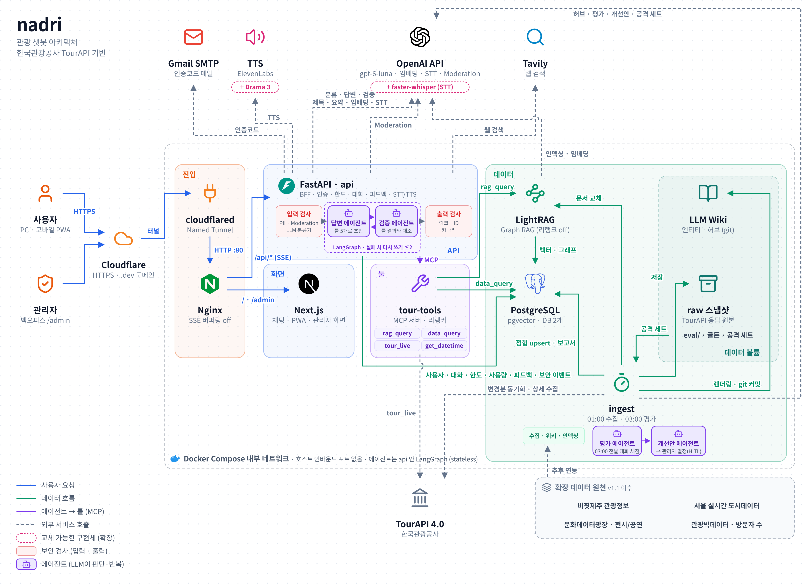
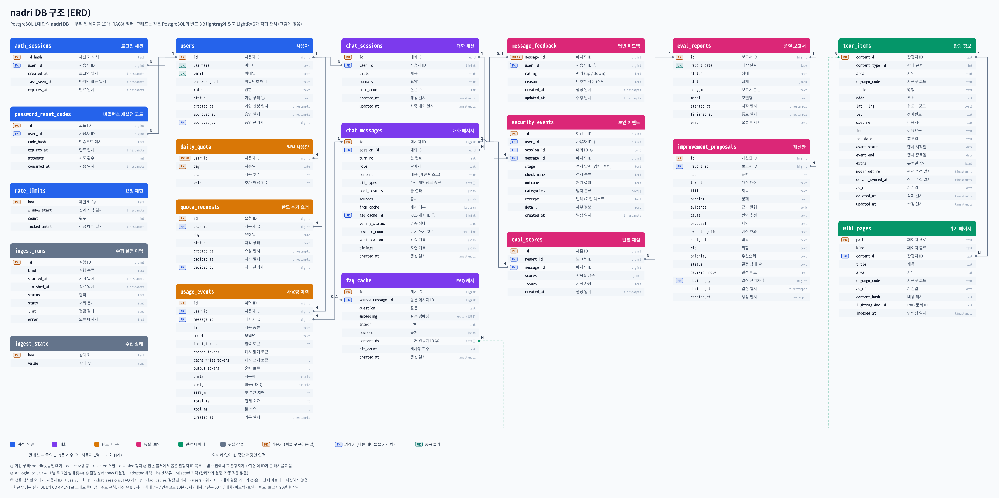

# nadri — 관광 챗봇

한국관광공사 **TourAPI 4.0** 공공데이터를 근거로 답하는 관광 챗봇입니다. PC·모바일 브라우저에서 동작합니다.

> **상태: 설계 단계 (구현 전)**
> 요구사항(G1)·기술스택(G2)·아키텍처(G3)가 승인되었고, 2026-11-21 에이전트 구조 변경(Hermes → LangGraph)·품질 평가·AI 보안을 반영해 G3를 재승인했고, 작업목록(G4, [`docs/harness/program_list.md`](docs/harness/program_list.md))도 승인되었습니다. 다음은 작업별 spec/test 작성(Phase 4)입니다. 진행 상황은 [`docs/harness/PROGRESS.md`](docs/harness/PROGRESS.md)에 있습니다.

## 무엇을 하나

- **근거 있는 답변**: 운영시간·요금·위치 같은 관광 정보는 LLM이 기억으로 답하지 않습니다. 공공데이터를 조회한 결과로만 답하고, **출처와 기준일**을 함께 보여 줍니다.
- **하이브리드 검색**: 조건·수치 질문("제주 동쪽 무료 관광지")은 정형 DB 조회로, 서술형 질문("비 오는 날 갈 만한 곳")은 위키 기반 Graph RAG로 답합니다.
- **최신 데이터 유지**: TourAPI의 변경분 동기화 API로 바뀐 항목만 다시 수집해 반영합니다.
- **스트리밍 채팅과 대화 이력**: 로그인한 사용자는 답변을 실시간으로 받고, 지난 대화를 다시 볼 수 있습니다.
- **음성 입출력**: 누르고 말하는(Push-to-talk) 음성 입력과 답변 읽어 주기(TTS)를 지원합니다.
- **답변 검증**: 답변 에이전트가 쓴 초안을 검증 에이전트가 툴 결과와 대조합니다. 틀리면 다시 쓰고(최대 2회), 통과하면 "✓ 확인됨"을 표시합니다.
- **매일 품질 평가**: 전날 대화를 평가 에이전트가 채점하고 개선안 에이전트가 개선안을 만듭니다. 적용 여부는 관리자가 직접 정합니다(Human-in-the-loop).
- **AI 보안**: 탈옥·프롬프트 인젝션·개인정보 노출을 여러 겹으로 막습니다. 자세한 내용은 아래 "보안" 절을 보세요.

## 아키텍처



실선은 내부 호출, 점선은 외부 서비스 호출입니다. 외부 접속은 Cloudflare Tunnel(`cloudflared` → Nginx)로만 받아 호스트에 여는 인바운드 포트가 없고, 나머지 서비스는 Docker Compose 내부 네트워크에만 둡니다.

## 기술 스택

| 영역 | 선택 |
|---|---|
| 프론트엔드 | Next.js 16 (App Router, TypeScript) + Tailwind CSS 4 + shadcn/ui, PWA, 관리자 백오피스(`/admin`) |
| 백엔드(BFF) | FastAPI (Python 3.12, uv) + SQLAlchemy 2.x(async) + Alembic |
| 에이전트 | **LangGraph** — 답변 에이전트 + 검증 에이전트 (api 안에서 실행) |
| LLM 호출 | **LangChain** (`ChatOpenAI`, `OpenAIEmbeddings`) · STT·Moderation만 OpenAI SDK |
| LLM | OpenAI API `gpt-6-luna` (답변·검증·분류·제목·요약·평가·인덱싱 통일) |
| 임베딩 | OpenAI `text-embedding-3-small` |
| Graph RAG | LightRAG + 리랭커 (`bge-reranker-v2-m3` CrossEncoder, tour-tools 내장) |
| DB | PostgreSQL + pgvector (단일 DB) |
| 툴 연결 | 자체 MCP 서버 `tour-tools` (공식 `mcp` Python SDK) |
| 웹 검색 | Tavily (`langchain-tavily`) |
| AI 보안 | 개인정보 가리기(규칙) + OpenAI Moderation API + LLM 분류기 + 검증 에이전트 |
| STT / TTS | OpenAI `gpt-transcribe` / ElevenLabs `eleven_flash_v2_5` (구현체 교체 가능한 인터페이스) |
| 리버스 프록시 · 외부 접속 | Nginx (SSE 버퍼링 off) + Cloudflare Named Tunnel (HTTPS, `.dev` 도메인) |
| 메일 | Gmail SMTP (비밀번호 재설정 인증코드) |
| 스케줄러 | APScheduler (`ingest` 컨테이너, 매일 01:00 현행화 · 03:00 품질 평가) |
| 테스트 | pytest · Vitest + React Testing Library · Playwright (Node LTS·npm, WSL2에서 실행) |
| 실행 | Docker Compose (WSL2 Ubuntu-22.04에서 개발) |

자세한 내용은 [`TECH_STACK.md`](TECH_STACK.md)에 있습니다.

## DB 구조 (ERD)



PostgreSQL 한 대 안에 DB를 2개 둡니다. `nadri` DB에는 위 그림의 앱 테이블 18개가 있고, RAG용 벡터·그래프는 별도 DB `lightrag`에 두며 LightRAG가 직접 관리합니다. 테이블·컬럼의 한글 명칭은 실제 DDL에도 `COMMENT`로 들어갑니다. 설계 근거는 [`docs/harness/architecture.md`](docs/harness/architecture.md) §5에 있습니다.

## 레포 구조 (계획)

```
myAgent/
├── compose.yaml        # 8개 서비스 (Docker Compose)
├── SECURITY_GUIDE.md   # AI 보안 가이드
├── web/                # Next.js — 챗봇 UI + 관리자 백오피스 + PWA
├── backend/            # Python(uv) — FastAPI(api) · LangGraph 에이전트 · 입력/출력 검사 · MCP 서버(tools) · 수집·평가(ingest)
├── infra/              # nginx, LightRAG 설정, PostgreSQL 초기화
├── eval/               # 골든 Q&A 평가셋 · 공격 질문 세트
└── docs/
    ├── analysis/       # 사전 분석
    ├── harness/        # 요구사항 · 아키텍처 · ERD · 작업목록 · 작업별 스펙
    └── images/         # 구성도 · ERD (src/에 생성 스크립트)
```

## 보안

LLM 보안은 한 번에 완벽히 막을 수 없어서, 여러 겹으로 막고 뚫려도 피해가 없게 권한을 최소로 둡니다.

- **입력 검사**: 대화 속 개인정보(주민번호·전화번호·카드번호 등)를 먼저 가리고, OpenAI Moderation API와 LLM 분류기로 유해 요청·탈옥·프롬프트 인젝션을 거릅니다. 검사가 실패하면 차단합니다.
- **최소 권한**: 에이전트가 쓸 수 있는 툴은 읽기 전용 5개뿐이고, 관광 툴 서버는 SELECT만 되는 DB 계정을 씁니다.
- **출력 검사**: 검증 에이전트가 프롬프트 유출·개인정보·관광 범위 이탈을 확인하고, 화면은 HTML·이미지를 렌더링하지 않으며 툴 결과에 있던 링크만 허용합니다.
- **개인정보**: 가린 텍스트만 저장하고, 위치 좌표는 저장하지 않으며, 대화는 90일 후 삭제합니다. 외부 추적 서비스로 대화를 보내지 않습니다.
- **점검**: 공격 질문 세트를 매일 돌려 방어율을 품질 보고서에 기록합니다.

자세한 설계는 [`SECURITY_GUIDE.md`](SECURITY_GUIDE.md)에 있습니다.

## 시작하기 (구현 후 채울 예정)

준비물:
- WSL2 Ubuntu-22.04 (또는 Linux) + Docker / Docker Compose
- [공공데이터포털](https://www.data.go.kr)에서 발급한 한국관광공사 TourAPI 인증키
- OpenAI API 키

API 키 같은 비밀값은 `.env` 파일에만 넣고, `.env`는 git에 커밋하지 않습니다.
실행 명령은 구현이 끝나면 이 섹션에 추가합니다.

## 개발 방식

이 레포는 [`debugs-choi-harnes`](https://github.com/r0cketspan/debugs-choi-harnes)의 승인 게이트 파이프라인을 따릅니다.

```
요구사항(G1) → 기술스택(G2) → 아키텍처(G3) → 작업목록(G4)
  → 작업별 spec/test → 작업 브랜치 구현 → dev 병합(G5) → E2E 테스트 설계
```

- 각 단계의 산출물은 [`docs/harness/`](docs/harness/)에 있습니다.
- 작업목록(G4)이 승인되기 전에는 소스코드를 작성하지 않습니다.
- 개발 규칙(주석, 커밋 등)은 [`CLAUDE.md`](CLAUDE.md)에 있습니다.

## 데이터 출처

이 서비스는 한국관광공사 TourAPI 4.0 데이터를 사용합니다. 이미지와 콘텐츠에는 공공누리 유형과 "한국관광공사" 출처를 표기합니다.

v1.1 이후에는 아래 데이터 원천을 단계적으로 추가할 계획입니다. 조사 내용은 [`docs/analysis/01-data-sources.md`](docs/analysis/01-data-sources.md)에 있습니다.

| 원천 | 데이터 |
|---|---|
| 비짓제주 관광정보 API (제주관광공사) | 제주 관광지·숙박·음식점·축제 상세 정보 |
| 서울 실시간 도시데이터 (서울시) | 주요 관광지 실시간 혼잡도 |
| 문화데이터광장 (한국문화정보원) | 전시·공연·문화행사 |
| 관광빅데이터 (한국관광공사) | 지역별 방문자 수 추이 |
