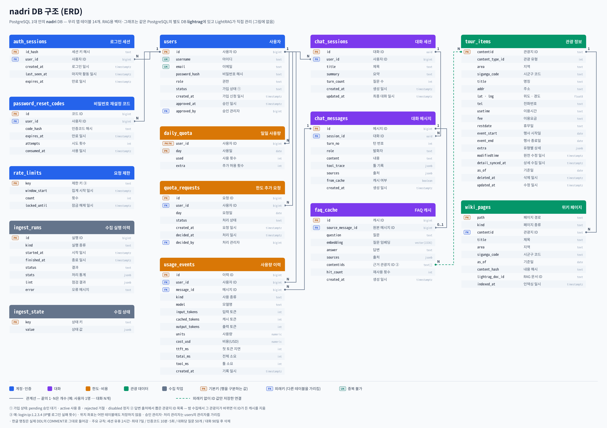

# ERD — `nadri` DB

> **G3 승인 (2026-11-07)**, README.md에 반영됨. 테이블·컬럼의 한글 명칭은 DDL `COMMENT`로 넣는다. 근거: `architecture.md` §5.1.
> `lightrag` DB는 LightRAG가 스스로 만들고 관리하므로 그리지 않는다(우리 코드는 HTTP API로만 접근).
> 표기: PK=기본키, FK=외래키, UK=유일. 초록 점선은 FK 없이 값으로만 연결되는 논리 관계.

원본: `docs/images/erd.svg` (PNG는 SVG에서 렌더링)

## 테이블 묶음
| 묶음 | 테이블 | 누가 쓰나 |
|---|---|---|
| 계정·인증 | users, auth_sessions, password_reset_codes, rate_limits | api |
| 대화 | chat_sessions, chat_messages, faq_cache | api (90일 삭제는 ingest) |
| 한도·비용 | daily_quota, quota_requests, usage_events | api, ingest(usage_events 일부) |
| 관광 데이터 | tour_items, wiki_pages | ingest 쓰기 / tour-tools 읽기 전용 |
| 수집 작업 | ingest_runs, ingest_state | ingest |
